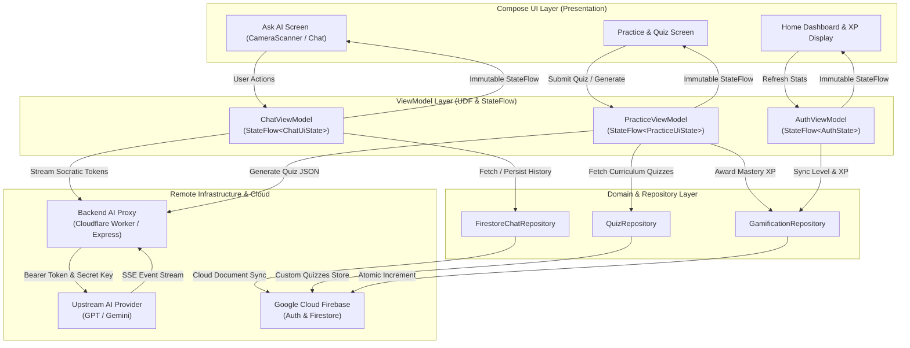

<div align="center">


# 🎓 Study Mentor — Socratic AI Study Companion
### *Guided Socratic Learning Assistant for Vietnamese High School Students (THPT & Ôn Thi Tốt Nghiệp)*

[](https://kotlinlang.org)
[](https://developer.android.com/jetpack/compose)
[](https://developer.android.com/training/camerax)
[](https://firebase.google.com)
[](https://platform.openai.com)

<p align="center">
  <b>Empowering Vietnamese high school students to master complex STEM & curriculum concepts through guided Socratic scaffolding (Hint First ➔ Step-by-Step ➔ Deep Insight), live CameraX viewfinder cropping, and motivating RPG progression.</b>
</p>

---

</div>

## 📖 Table of Contents
- [🎯 Strategic Positioning & Target Persona](#-strategic-positioning--target-persona)
- [💡 Why Not Just ChatGPT or Gemini? (Product Differentiation)](#-why-not-just-chatgpt-or-gemini-product-differentiation)
- [✨ Core Pedagogical & Technical Features](#-core-pedagogical--technical-features)
  - [1. Socratic 3-Stage Guided Flow](#1-socratic-3-stage-guided-flow)
  - [2. Interactive Resizable Crop Viewfinder (CameraX)](#2-interactive-resizable-crop-viewfinder-camerax)
  - [3. Resilient SSE Token Streaming Pipeline](#3-resilient-sse-token-streaming-pipeline)
  - [4. RPG Gamification & Mastery Accuracy Rewards](#4-rpg-gamification--mastery-accuracy-rewards)
  - [5. Curriculum-Aligned Practice & AI Quiz Generator](#5-curriculum-aligned-practice--ai-quiz-generator)
  - [6. Transparent Cloud Study History & Multi-Tier Auth](#6-transparent-cloud-study-history--multi-tier-auth)
- [🛠️ Tech Stack & Architecture](#️-tech-stack--architecture)
- [📂 Project Structure](#-project-structure)
- [🚀 Installation & Setup](#-installation--setup)
- [🔐 Environment & Secrets Configuration](#-environment--secrets-configuration)
- [🚀 Future Roadmap (Post-Competition)](#-future-roadmap-post-competition)
- [🏆 Best Coder 2026 Competitive Highlights](#-best-coder-2026-competitive-highlights)

---

## 🎯 Strategic Positioning & Target Persona

### The Core Problem in Modern EdTech
Most existing AI homework solvers operate as **passive "answer-dumping vending machines"**:
1. Students snap a photo and immediately receive the final option (`A`, `B`, `C`, `D`) or a full solution copy-pasted directly into their homework.
2. This creates **cognitive dependency** and an illusion of competence: students complete worksheets quickly without understanding the underlying principles, resulting in severe performance drops during unassisted exams.

### Our Target Persona: High School Students (Grades 10–12)
- **Primary Goal**: Preparing for high school graduation exams, university entrance tests, and rigorous STEM curriculum mastery.
- **Core Pain Point**: High-stakes exams require problem decomposition, formula adaptation under time pressure, and deep conceptual understanding—skills completely bypassed by generic answer generators.
- **Our Value Proposition**: **Study Mentor** acts as a dedicated **Socratic Mentor**, actively guiding students to discover solutions themselves through structured hints, conceptual scaffolding, and exam-aligned tips.

---

## 💡 Why Not Just ChatGPT or Gemini? (Product Differentiation)

| Dimension | Generic LLM Chatbots (ChatGPT / Gemini) | Study Mentor (Socratic Companion) |
| :--- | :--- | :--- |
| **Pedagogy** | Dumps full solutions immediately; encourages passive copy-pasting | **Socratic Guidance**: Hint First ➔ Step-by-Step ➔ Deep Insight & Exam Tips |
| **Curriculum Context** | Broad, generic international knowledge; misses regional exam nuances | **Bespoke THPT Alignment**: Calibrated for Vietnamese GDPT (Toán 12, Lý, Hóa, Sinh, Văn, Sử) |
| **Mobile Capture Friction** | Generic photo upload requires switching apps or manually typing formulas | **Fluid Resizable Viewfinder**: One-tap ROI bounding-box cropping with EXIF rotation |
| **Feedback & Engagement** | Flat conversational threads; easily forgotten after copying | **RPG Gamification**: XP, 10 mastery ranks, and +20% accuracy bonuses for thorough comprehension |
| **Study History** | Cluttered chronological chat history without subject metadata | **Scoped Cloud Session Store**: Filterable by subject, format, timestamp, with full replay |

---

## ✨ Core Pedagogical & Technical Features

### 1. Socratic 3-Stage Guided Flow
Whenever a student asks a question or captures a problem, `OpenAIApiClient` and `ChatViewModel` dynamically inject a pedagogical prompt enforcing a structured 3-stage response:
1. 💡 **Hint First**: Identifies the core formula, theorem, or initial guiding question without giving away the final arithmetic or option.
2. 🧭 **Step-by-Step Guidance**: Breaks the problem into logical checkpoints as the student interacts.
3. ⚡ **Deep Insight & Exam Tips**: Explains the underlying physical/mathematical mechanism, flags common exam traps, and demonstrates rapid elimination and calculation shortcuts.

### 2. Interactive Resizable Crop Viewfinder & Binary Image Pipeline
- **Fluid Gesture Manipulation**: Built on Jetpack Compose `pointerInput` and `detectDragGestures`. Students grab any of the 4 corner handles to expand, contract, or pan the bounding box directly over the question of interest.
- **Dynamic Punch-Out Shader**: Uses an offscreen graphics layer (`CompositingStrategy.Offscreen`) with `BlendMode.Clear` to punch a 100% transparent cutout over the live CameraX preview while dimming outer areas with `Color.Black.copy(alpha = 0.6f)`.
- **Memory-Safe Downscaling & Binary Multipart Upload (P-12)**:
  - All bitmap decoding, scaling, and compression execute strictly on `Dispatchers.Default`.
  - Cropped images are downscaled proportionally so the longest edge is at most `1024px` using `inJustDecodeBounds` / `inSampleSize`, compressed to `JPEG 75–80%` quality, and intermediate bitmaps are explicitly recycled (`.recycle()`).
  - Raw binary image bytes are uploaded directly via `multipart/form-data` to the backend proxy, eliminating the ~33% Base64 transmission overhead on mobile networks.

### 3. Low-Latency SSE Token Streaming Pipeline
- **Low-Latency Streaming (Reduced Time-To-First-Token / TTFT via SSE)**: High-performance HTTP streaming using native `HttpURLConnection` and coroutines `Flow<String>`, parsing `data: {...}` lines on `Dispatchers.IO`.
- **Performance Benchmark Instrumentation**: Logs exact `Upload Payload Size (KB)`, `TTFT (Time-To-First-Token in ms)`, and `Total Stream Time (ms)` on every request under the `PerfBenchmark` tag.
- **Fail-Fast Mobile Timeouts**: `connectTimeout = 10_000` (10s) and `readTimeout = 20_000` (20s) ensure dropped mobile cellular/Wi-Fi packets fail immediately rather than hanging indefinitely.
- **Type-Safe Exception Resilience**: Granular handling for `SocketTimeoutException`, `ConnectException`, `UnknownHostException`, and `IOException`, with guaranteed loading/streaming state reset in `finally`.

### 4. RPG Gamification & Mastery Accuracy Rewards
- **Progress Progression**:
  $$\text{Level} = \left\lfloor \frac{\text{Total XP}}{100} \right\rfloor + 1$$
- **10 Distinct Mastery Ranks**:
  `Novice (Lvl 1)` ➔ `Scholar (Lvl 2)` ➔ `Adept (Lvl 3)` ➔ `Specialist (Lvl 4)` ➔ `Expert (Lvl 5)` ➔ `Master (Lvl 6)` ➔ `Grandmaster (Lvl 7)` ➔ `Champion (Lvl 8)` ➔ `Legend (Lvl 9)` ➔ `Mythic (Lvl 10+)`.
- **Mastery Accuracy Bonuses**:
  - Base Proportional XP: $\frac{\text{Correct}}{\text{Total}} \times \text{Max XP}$
  - **100% Perfect Score Bonus**: $+20\%$ extra XP rewarding thorough mastery.
  - **$\ge 80\%$ High Comprehension Bonus**: $+10\%$ extra XP rewarding consistent effort.

### 5. Curriculum-Aligned Practice & AI Quiz Generator
- **System THPT Curriculum Quizzes**: Seeded with authentic Grade 12 National Exam modules:
  - *Toán 12 — Khảo sát hàm số & Tích phân*
  - *Vật lý 12 — Dao động điều hòa & Sóng cơ*
  - *Hóa học 12 — Este, Lipit & Cacbohiđrat*
- **Dynamic AI Quiz Generation**: Students configure topic (e.g. *"Di truyền Menđen"*, *"Sóng ánh sáng"*), question count (5 or 10), format (trắc nghiệm / tự luận), and receive custom quizzes directly generated by the AI and saved to their Firestore profile.

### 6. Transparent Cloud Study History & Multi-Tier Auth
- **Scoped User History**: All study chats, attached image references, and AI responses are persisted under user-scoped Firestore sub-collections (`users/{uid}/chats`).
- **Authentication Resilience**: Full guest exploration allowed with clean prompts to sign in via Firebase Auth to sync XP and access custom quizzes.

---

## 🛠️ Tech Stack & Architecture

### Unidirectional Data Flow (UDF) & Clean Architecture
Study Mentor enforces strict **MVVM** where state flows down immutably via `StateFlow<UiState>` and user intent flows up via typed ViewModel events. Repositories return immutable domain models or `Flow<T>`, ensuring complete separation between business logic and the Compose UI layer.



| Technology | Purpose |
| :--- | :--- |
| **Kotlin 2.2.10** | Modern, concise, null-safe language for Android |
| **Jetpack Compose (BOM 2026.02.01)** | Declarative UI toolkit with Material Design 3 guidelines |
| **AndroidX CameraX (1.4.1)** | Lifecycle-aware camera hardware preview and high-speed image capture |
| **Navigation Compose (2.8.5)** | Single-activity backstack and animated tab navigation |
| **Firebase Auth & Cloud Firestore** | User authentication and real-time cloud document database |
| **Kotlin Coroutines & StateFlow** | Asynchronous background processing and unidirectional reactive state |
| **Custom SSE HttpURLConnection** | Low-latency Server-Sent Events parser delivering real-time streaming tokens |
| **Coil Compose (2.6.0)** | Asynchronous image decoding, memory caching, and disk cache management |
| **AndroidX ExifInterface** | High-precision sensor rotation mapping for camera captures |

---

## 📂 Project Structure

```text
Study_Mentor_BTEC_BestCode/
├── app/
│   ├── build.gradle.kts                # Application build config & dependencies
│   ├── google-services.json            # Firebase configuration file
│   └── src/main/
│       ├── AndroidManifest.xml         # Permissions, cleartext config & MainActivity
│       ├── res/xml/
│       │   └── network_security_config.xml # Cleartext & trusted certificate anchors
│       └── java/com/example/study_mentor/
│           ├── MainActivity.kt         # Edge-to-Edge root Activity
│           ├── OpenAIApiClient.kt      # SSE Streaming client with Socratic prompt & timeouts
│           ├── data/                   # Data Models & Repositories
│           │   ├── ChatModels.kt       # Chat message & session schemas
│           │   ├── GamificationModels  # RPG level math & UserStats
│           │   ├── GamificationRepo    # Firestore XP increment logic
│           │   ├── FirestoreChatRepo   # Cloud session persistence
│           │   ├── QuizModels.kt       # Multi-choice schemas & mastery XP math
│           │   └── QuizRepository.kt   # THPT curriculum modules & Firestore custom quizzes
│           └── ui/                     # Presentation Layer (Compose)
│               ├── MainScreen.kt       # Bottom navigation & RGB glowing FAB
│               ├── CameraScannerScreen # Live CameraX & Resizable Crop Viewfinder
│               ├── HomeScreen.kt       # Socratic greeting, suggestions & XP dashboard
│               ├── PracticeScreen.kt   # THPT quizzes & AI custom quiz builder
│               ├── QuizTakingScreen.kt # Interactive test engine with mastery bonuses
│               ├── LibraryScreen.kt    # Past session replay list with subject tags
│               ├── ProfileScreen.kt    # User stats, rank title & avatar selector
│               ├── AuthViewModel.kt    # Firebase auth & stats observer
│               ├── ChatViewModel.kt    # Socratic prompt builder & AI stream manager
│               └── theme/              # Color palette, Shapes, & Typography
├── art/                                # Project branding & screenshot assets
├── build.gradle.kts                    # Root build configuration
├── gradle.properties                   # JVM & memory configuration
└── settings.gradle.kts                 # Repositories & plugin declarations
```

---

## 🚀 Installation & Setup

### Prerequisites
- **Android Studio**: Ladybug (2024.2.1+) or newer.
- **JDK**: Version 17 or Version 21.
- **Android Device / Emulator**: Running Android 10.0 (API level 29) or higher with camera support.

### Step-by-Step Instructions

1. **Clone the Repository**:
   ```bash
   git clone https://github.com/your-username/Study_Mentor_BTEC_BestCode.git
   cd Study_Mentor_BTEC_BestCode
   ```

2. **Configure API Secrets (`local.properties`)**:
   Create or open the `local.properties` file in the project's root folder and append your AI API Key:
   ```properties
   ## Local Environment Configurations
   sdk.dir=C\:\\Users\\YourUsername\\AppData\\Local\\Android\\Sdk
   
   # AI Service API Key for OpenAI / Proxy endpoint
   AI_API_KEY=sk-your-actual-api-key-here
   ```

3. **Add Firebase Credentials (`google-services.json`)**:
   - Create a project on the [Firebase Console](https://console.firebase.google.com/).
   - Add an Android App with package name: `com.example.study_mentor`.
   - Download the generated `google-services.json` and place it in the `app/` folder:
     ```text
     Study_Mentor_BTEC_BestCode/app/google-services.json
     ```
   - In Firebase Console, enable **Email/Password Authentication** and **Cloud Firestore Database**.

4. **Build & Run**:
   Compile and deploy directly from Android Studio or via Gradle CLI:
   ```bash
   # Build debug APK
   ./gradlew assembleDebug

   # Install onto connected Android device
   ./gradlew installDebug
   ```

---

## 🔐 Environment & Security Architecture (P-09 Compliance)

To satisfy strict security criteria and prevent malicious extraction of proprietary credentials:
- **Zero Raw AI API Keys in the Client APK**: Reverse engineering the compiled APK (`.apk` decompiled via `jadx` or `apktool`) reveals **zero raw provider API keys**.
- **Backend AI Proxy Pattern**: The client application communicates with a secure server-side proxy endpoint configured via `BuildConfig.AI_PROXY_BASE_URL` (located in [`/backend-proxy`](backend-proxy/)).
- **Authenticated Request Authorization**: When a student is signed in, `OpenAIApiClient` automatically resolves their current Firebase ID Token:
  ```kotlin
  FirebaseAuth.getInstance().currentUser?.getIdToken(false)?.await()?.token
  ```
  and attaches it in the request header (`Authorization: Bearer <idToken>`).
- **Server-Side Secret Injection**: The backend proxy validates the caller, injects the secret `AI_API_KEY` from isolated server environment variables, and streams real-time SSE tokens back to the Android client.
- **Local Environment Configuration**:
  In `local.properties`:
  ```properties
  # Base URL pointing to your deployed backend proxy or local emulator proxy
  AI_PROXY_BASE_URL=https://study-mentor-proxy.workers.dev/v1/chat/completions
  ```

---

## 🧪 Unit Testing & UDF State Verification

The codebase includes automated unit test suites in `app/src/test/` to verify Unidirectional Data Flow, immutable state transitions, and pedagogical calculation math:
- **`ChatViewModelTest`**: Verifies initial state purity, subject filter toggle logic, input text buffering, and incremental token streaming into `ChatUiState`.
- **`PracticeViewModelTest`**: Verifies reactive quiz loading, `calculateEarnedXp` with 100% (+20%) and 80% (+10%) mastery bonuses, and dynamic AI custom quiz creation UDF state transitions (`isGeneratingQuiz` loading -> false).
- **`AiQuizGeneratorUnitTest`**: Validates JSON fence sanitization, conversational preamble stripping, and dynamic question math.

### Executing Unit Tests via CLI
Run all unit tests with the standard Gradle command:
```bash
./gradlew testDebugUnitTest
```

---

## 🚀 Future Roadmap (Post-Competition)

The features listed below are architected for our post-competition enterprise and institutional expansion, keeping the core competition demo 100% focused on verified, rock-solid functionality:

1. **Automated Parental Consent & COPPA Verification Portal**:
   - Web-based and mobile SMS-linked parent dashboard to approve AI study usage, view aggregate study hours, and monitor curriculum progress without exposing private chat details.
2. **Interactive Student Onboarding & Diagnostic Placement**:
   - Initial multi-subject assessment test upon first launch to calibrate student skill baseline and automatically recommend tailored study tracks.
3. **Peer-to-Peer Study Rooms & Teacher Classroom Management**:
   - Real-time collaborative Socratic rooms where students can work through exam modules together, with teacher dashboards to assign curriculum-aligned AI quizzes.
4. **Offline Local LLM Fallback (Mobile On-Device Inference)**:
   - On-device lightweight quantized SLM (e.g., Gemma 2B via MediaPipe) for basic hint generation and formula lookups when operating completely offline without cellular reception.

---

## 🏆 Best Coder 2026 Competitive Highlights

- **Pedagogy First (P-02)**: Eliminates academic shortcutting by enforcing the Socratic 3-Stage scaffolding.
- **Curriculum Alignment (P-03)**: Focused specifically on Vietnamese High School Graduation Exam (Toán 12, Lý, Hóa, Sinh, Văn, Sử) competencies.
- **Hardware-Accelerated UX (P-04)**: Resizable gesture-driven viewfinder crop over live CameraX feed with instant ROI sub-sampling.
- **Continuous Retention Loop (P-13)**: RPG leveling curve paired with +20% accuracy mastery bonuses, making daily exam preparation engaging and motivating.

---
