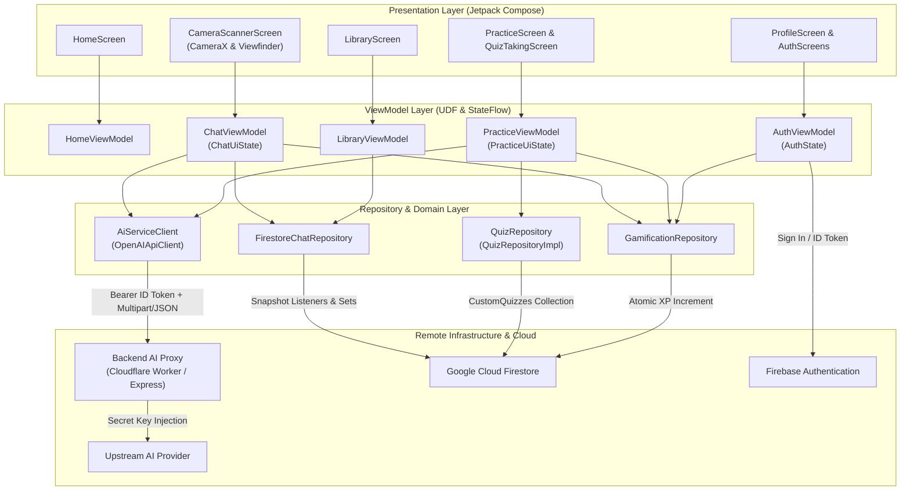

# Study Mentor — Socratic AI Study Companion

> A native Android Socratic learning assistant designed for high school students, featuring live camera Region-of-Interest (ROI) cropping, low-latency Server-Sent Events (SSE) AI streaming, curriculum practice assessments, and RPG-style mastery gamification.

[](https://kotlinlang.org)
[](https://developer.android.com/studio/releases/gradle-plugin)
[](https://developer.android.com)
[](https://developer.android.com/jetpack/compose)
[](https://m3.material.io)
[](https://developer.android.com/training/camerax)
[](https://firebase.google.com)

---

## Table of Contents

- [1. Overview](#1-overview)
- [2. Key Features](#2-key-features)
- [3. Screenshots](#3-screenshots)
- [4. Technology Stack](#4-technology-stack)
- [5. Application Architecture](#5-application-architecture)
- [6. Project Structure](#6-project-structure)
- [7. Installation and Setup](#7-installation-and-setup)
- [8. Configuration](#8-configuration)
- [9. Application Workflow](#9-application-workflow)
- [10. API and External Services](#10-api-and-external-services)
- [11. Testing](#11-testing)
- [12. Current Development Status](#12-current-development-status)
- [13. Contributing](#13-contributing)
- [14. License](#14-license)

---

## 1. Overview

### Problem Statement
Most mobile homework helpers function as passive answer-vending machines: students take a photo of an assignment and immediately receive the final option or complete numerical answer. This creates cognitive dependency and an illusion of competence, leading to failure when students face unassisted high-stakes examinations.

### Solution and Purpose
**Study Mentor** replaces passive answer dumping with active, pedagogical scaffolding. When a student captures or types a problem, the application enforces a **3-stage Socratic guidance flow**:
1. **Hint First**: Recalls the foundational theorem, relevant formula, or initial guiding question without revealing final calculations.
2. **Step-by-Step Guidance**: Breaks the problem into logical milestones upon follow-up.
3. **Deep Conceptual Insight & Exam Tips**: Clarifies common exam traps, shortcut checks, and fundamental principles.

### Intended Users
- High school students (Grades 10–12) preparing for national graduation exams, university entrance tests, and STEM assessments.
- Independent learners seeking step-by-step guidance rather than rote answers.

### Key Capabilities
- **Hardware-Accelerated CameraX Viewfinder**: Direct back-facing camera preview with flashlight control and gallery import.
- **Interactive ROI Cropping**: 4-corner gesture-resizable bounding box with an offscreen punch-out shader dimming background clutter.
- **Bandwidth-Optimized Vision Upload**: Transmits raw binary JPEG chunks directly via `multipart/form-data` to reduce mobile data consumption by ~33% compared to Base64 JSON payloads.
- **Resilient SSE Token Streaming**: Incremental character-by-character streaming over native `HttpURLConnection` with strict network timeouts (10s connect / 20s read).
- **Client-Side LaTeX Sanitizer**: Cleans raw LaTeX delimiters and translates LaTeX command tokens (`\perp`, `\parallel`, `\sqrt`, `\frac`) into standard Unicode mathematical typography.
- **Curriculum & AI Quizzes**: Authentic Grade 12 National Exam practice modules combined with an AI assessment generator utilizing OpenAI-compatible Structured Outputs.
- **RPG Gamification**: 10 progressive mastery ranks (Level 1 *Novice* through Level 10+ *Mythic*), proportional XP scoring, and accuracy bonuses (+20% for 100% correct, +10% for $\ge 80\%$ correct).
- **Cloud History Persistence**: Real-time study session history and profile synchronization using Google Cloud Firestore.

---

## 2. Key Features

### Implemented Features

#### 1. Socratic AI Tutoring & Contextual Prompting
- **Pedagogical System Contract**: Strictly instructs the AI model to guide rather than answer, enforcing 100% English explanations.
- **Interactive Context Filters**: Context chips allowing students to select subject domain (*Math*, *Physics*, *Chemistry*, *Biology*, *Literature*, *General*) and mentoring mode (*Hint First*, *Step-by-Step*, *Simplified*, *Alternative Method*, *Deep Concept*, *Check My Work*).
- **Dynamic Prompt Injection**: Automatically prepends subject context and appends pedagogical constraints before dispatching to the streaming engine.
- **Client-Side Math Formatting**: Built-in `cleanAiFormatting()` engine strips raw LaTeX syntax and formats fractions and square roots into clean, readable text.

#### 2. CameraX Hardware Vision & Crop Engine
- **Lifecycle-Bound PreviewView**: Uses `PreviewView.ImplementationMode.PERFORMANCE` (SurfaceView) for low-latency preview rendering.
- **Interactive ROI Bounding Box**: Four touch-sensitive corner handles driven by `detectDragGestures` with coordinate boundary clamping.
- **Punch-Out Cutout Shader**: Employs Compose `Canvas` with `BlendMode.Clear` to punch a transparent aperture over the camera feed while applying a 60% black scrim to peripheral noise.
- **EXIF Auto-Rotation**: Corrects orientation discrepancies ($90^\circ, 180^\circ, 270^\circ$) from camera sensor hardware.
- **Memory-Safe Downsampling**: Uses `BitmapFactory.Options.inSampleSize` on `Dispatchers.Default` to cap image dimensions at 1024x1024, compressing to 78% JPEG quality with explicit `.recycle()` calls.

#### 3. Low-Latency Streaming Pipeline & Backend AI Proxy
- **Real-Time Token Flow**: Reads Server-Sent Events (`text/event-stream`) line-by-line, emitting tokens as a coroutine `Flow<String>`.
- **Backend AI Proxy Architecture**: Decouples the client APK from proprietary AI API keys. The client authenticates using a Firebase ID Token, and the proxy injects server-side environment secrets.
- **Binary Multipart Upload**: Sends binary image data directly to the proxy, bypassing Base64 size expansion on mobile networks.
- **Resilient Network Handling**: Configured with 10-second connection and 20-second read timeouts, safely handling `SocketTimeoutException`, `ConnectException`, `UnknownHostException`, and `IOException`.

#### 4. Curriculum Practice & AI Quiz Generator
- **Seeded THPT Curriculum Quizzes**: Pre-loaded with authentic high school exam modules:
  - *High School Math — Functions & Calculus* (5 questions: monotonicity, logarithmic domain, extrema, 3D vectors, definite integrals).
  - *High School Physics — Harmonic Motion & Waves* (5 questions: angular frequency, amplitude, phase difference, wave speed, interference).
  - *High School Chemistry — Organic Reactions & Stoichiometry* (4 questions: ester formulas, disaccharides, triglyceride hydrolysis, esterification).
- **Structured AI Quiz Generation**: Generates custom quizzes based on user topic, question count (5 or 10), format (Multiple Choice or Short Answer), and language using OpenAI-compatible JSON schemas.
- **Defensive Deserialization**: Employs `kotlinx.serialization` with boundary validation to ensure question integrity before saving to Firestore.
- **Interactive Test Execution**: Offers instant question-by-question feedback or post-submission grading, ambient audio playback (`bg_music_beneath_rain.mp3`), and score dialogs.

#### 5. RPG Gamification & Mastery Rewards
- **Progression Math**: Level calculated as $\lfloor \text{totalXp} / 100 \rfloor + 1$.
- **10 Mastery Ranks**: *Novice*, *Scholar*, *Adept*, *Specialist*, *Expert*, *Master*, *Grandmaster*, *Champion*, *Legend*, *Mythic*.
- **Accuracy Bonuses**: Proportional base score plus a **+20% Perfect Score Bonus** (100% accuracy) and a **+10% High Comprehension Bonus** ($\ge 80\%$ accuracy).
- **Atomic Cloud Increments**: Safely writes XP awards to Firestore using `FieldValue.increment`.

#### 6. Cloud Study History & User Profile
- **Session Archive (Library)**: Reactive Firestore listener on `users/{uid}/chat_sessions` with real-time text search and subject filtering.
- **Swipe-to-Dismiss**: Deletes sessions and nested message subcollections from Firestore.
- **Session Replay**: Reloads full conversation histories into the active chat session with one tap.
- **Profile Customization**: Updates display name in Firebase Auth and downsamples gallery avatars to max 300x300 JPEG (70% quality), saving the Base64 representation in Firestore.

### Partially Implemented / Prototype Features
- **Home Recent Activity**: The "Recent Questions" section in `HomeScreen.kt` is currently backed by mock data in `HomeViewModel.kt` (`/* TODO: Fetch from Room/Firestore History */`). Active user history is fully operational in the `LibraryScreen.kt`.

### Planned Features (Future Roadmap)
- **Parental Consent & COPPA Verification Portal**: Web/SMS-linked parent dashboard for usage monitoring.
- **Diagnostic Placement Assessment**: Diagnostic test upon first launch to calibrate student baseline.
- **Peer-to-Peer Study Rooms**: Collaborative study sessions and educator classroom management.
- **Offline On-Device SLM Inference**: Local quantized model execution (e.g., Gemma 2B via MediaPipe) for basic offline hints.

---

## 3. Screenshots

<div align="center">
  
</div>

> **Note on Interface Screenshots:**  
> Captured screenshots demonstrating the live application interface will be added in this section.
>
> Planned captures:
> - `art/screenshot_home.png`: Dashboard showing time-aware greeting, streak, and RPG level progress.
> - `art/screenshot_camerax_crop.png`: CameraX live viewfinder with 4-corner interactive ROI resizable bounding box.
> - `art/screenshot_socratic_chat.png`: Real-time Socratic streaming conversation with Unicode math rendering.
> - `art/screenshot_practice_quiz.png`: Curriculum assessment screen and interactive question feedback.
> - `art/screenshot_library.png`: Filterable study session history with swipe-to-delete.

---

## 4. Technology Stack

### Programming Language
- **Kotlin `2.2.10`**: 100% of the application codebase is written in Kotlin.

### Android Platform & SDK
- **Minimum SDK**: `29` (Android 10.0)
- **Target SDK**: `37` (Android 16 release preview)
- **Compile SDK**: `37`
- **Android Gradle Plugin (AGP)**: `9.4.1`
- **Gradle Version**: `9.6.0`

### UI Framework
- **Jetpack Compose BOM `2026.02.01`**: Declarative UI layer.
- **Material 3**: Material Design components, dynamic palettes, and typography.
- **Navigation Compose `2.8.5` / `2.7.7`**: Single-activity navigation graph and typed arguments.
- **Material Icons Extended**: Vector iconography.

### Architecture & Concurrency
- **Architecture Pattern**: MVVM (Model-View-ViewModel) with Unidirectional Data Flow (UDF) and Repository Pattern.
- **Kotlin Coroutines `1.8.1`**: Asynchronous background operations.
- **StateFlow & SharedFlow**: Reactive state management and one-time event dispatch.

### Hardware & Media
- **AndroidX CameraX `1.4.1`**: Core, Camera2, Lifecycle, and View modules for camera controls.
- **Coil Compose `2.6.0`**: Asynchronous image loading and memory caching.
- **Android MediaPlayer**: Background audio playback for quiz sessions.

### Cloud Backend & APIs
- **Firebase Auth `24.2.0` (BOM `33.4.0`)**: User authentication and session token issuance.
- **Cloud Firestore (BOM `33.4.0`)**: NoSQL cloud database for user profiles, sessions, and custom quizzes.
- **Native `HttpURLConnection`**: Custom Server-Sent Events (SSE) token parser.
- **Kotlinx Serialization JSON `1.7.3`**: Type-safe schema deserialization.
- **Backend AI Proxy (`backend-proxy/`)**: Cloudflare Worker / Express server isolating secret AI API keys.

### Development & Testing Tools
- **JUnit `4.13.2`**: Unit testing framework.
- **MockK `1.13.10`**: Mocking library for Kotlin coroutines and Firebase services.
- **Kotlinx Coroutines Test `1.8.1`**: Dispatcher control and coroutine testing.
- **AndroidX Test JUnit `1.3.0` & Espresso Core `3.7.0`**: Android instrumented test runner.

---

## 5. Application Architecture

The application implements **Unidirectional Data Flow (UDF)** combined with **MVVM** and the **Repository Pattern**. Presentation components subscribe to immutable `StateFlow` streams exposed by ViewModels, while user interactions trigger explicit ViewModel methods.



### Navigation Graph

The application uses a single `ComponentActivity` (`MainActivity.kt`) hosting an edge-to-edge Compose `NavHost`:

| Route Pattern | Target Composable | Description | Bottom Bar |
| :--- | :--- | :--- | :---: |
| `"home"` | `HomeScreen` | Dashboard with streak, XP progress, and subject chips | Visible |
| `"practice"` | `PracticeScreen` | Curriculum quiz selector and AI quiz generation | Visible |
| `"quiz_taking/{quizId}"` | `QuizTakingScreen` | Immersive quiz testing screen with instant feedback | **Hidden** |
| `"ask_ai"` | `CameraScannerScreen` | CameraX live viewfinder, ROI cropping, and Socratic chat | Visible |
| `"library"` | `LibraryScreen` | Cloud study session history with swipe-to-delete | Visible |
| `"profile"` | `ProfileScreen` | User rank, avatar customization, and authentication | Visible |
| `"login"` | `LoginScreen` | Account login form | **Hidden** |
| `"register"` | `RegisterScreen` | Account registration form | **Hidden** |

---

## 6. Project Structure

```text
Study_Mentor_BTEC_BestCode/
├── app/
│   ├── build.gradle.kts                # Application build configuration and dependencies
│   ├── google-services.json            # Firebase client configuration (not exposed in git)
│   └── src/
│       ├── androidTest/                # On-device Android instrumented tests
│       │   └── java/com/example/study_mentor/
│       │       └── ExampleInstrumentedTest.kt
│       ├── main/
│       │   ├── AndroidManifest.xml     # Permissions, activity declaration, and FileProvider
│       │   ├── keepRules/rules.keep    # R8 / ProGuard optimization rules
│       │   ├── res/                    # Drawables, raw audio, strings, colors, and XML configs
│       │   └── java/com/example/study_mentor/
│       │       ├── MainActivity.kt     # Edge-to-edge entry point Activity
│       │       ├── OpenAIApiClient.kt  # SSE streaming, binary multipart, and timeouts
│       │       ├── data/               # Domain models and data repositories
│       │       │   ├── ChatModels.kt
│       │       │   ├── FirestoreChatRepository.kt
│       │       │   ├── GamificationModels.kt
│       │       │   ├── GamificationRepository.kt
│       │       │   ├── QuizModels.kt
│       │       │   └── QuizRepository.kt
│       │       └── ui/                 # Jetpack Compose UI screens and ViewModels
│       │           ├── MainScreen.kt
│       │           ├── HomeScreen.kt
│       │           ├── HomeViewModel.kt
│       │           ├── CameraScannerScreen.kt
│       │           ├── ChatViewModel.kt
│       │           ├── PracticeScreen.kt
│       │           ├── PracticeViewModel.kt
│       │           ├── QuizTakingScreen.kt
│       │           ├── LibraryScreen.kt
│       │           ├── LibraryViewModel.kt
│       │           ├── ProfileScreen.kt
│       │           ├── AuthViewModel.kt
│       │           ├── LoginScreen.kt
│       │           ├── RegisterScreen.kt
│       │           └── theme/
│       └── test/                       # Local JVM unit test suites
│           └── java/com/example/study_mentor/
│               ├── AiQuizGeneratorUnitTest.kt
│               ├── ChatViewModelTest.kt
│               ├── ExampleUnitTest.kt
│               ├── PracticeViewModelTest.kt
│               └── QuizDeserializationUnitTest.kt
├── art/                                # Application branding and visual assets
├── backend-proxy/                      # Standalone AI proxy implementations
│   ├── README.md                       # Proxy deployment guide
│   ├── server.js                       # Node.js Express server
│   └── worker.js                       # Cloudflare Worker script
├── build.gradle.kts                    # Root build configuration
├── gradle.properties                   # JVM memory and build optimization flags
├── gradlew / gradlew.bat               # Gradle wrapper executable scripts
├── local.properties                    # Local SDK paths and proxy endpoint configuration
└── settings.gradle.kts                 # Project naming and repository resolutions
```

---

## 7. Installation and Setup

### Prerequisites
- **Android Studio**: Ladybug (2024.2.1) or newer recommended.
- **JDK**: Java Development Kit version 17, 21, or 25 installed and configured.
- **Android SDK**: Android API level 37 build tools installed via SDK Manager.
- **Device / Emulator**: Physical Android device or emulator running **Android 10.0 (API level 29)** or higher. A physical camera is required for camera capture; emulator camera feeds or gallery image selection may be used as alternatives.

### Step-by-Step Instructions

1. **Clone the repository**:
   ```bash
   git clone https://github.com/your-username/Study_Mentor_BTEC_BestCode.git
   cd Study_Mentor_BTEC_BestCode
   ```

2. **Configure Local Environment (`local.properties`)**:
   Create a `local.properties` file in the project root directory (if not generated automatically by Android Studio) and configure the Android SDK directory and the backend proxy URL:
   ```properties
   ## Android SDK location (adjust to your local system path)
   sdk.dir=C\:\\Users\\YourUsername\\AppData\\Local\\Android\\Sdk

   ## Backend AI Proxy Endpoint (defaults to Cloudflare Worker proxy if omitted)
   AI_PROXY_BASE_URL=https://study-mentor-proxy.workers.dev/v1/chat/completions
   ```

3. **Add Firebase Credentials (`google-services.json`)**:
   - Create a project on the [Firebase Console](https://console.firebase.google.com/).
   - Add an Android application with package name `com.example.study_mentor`.
   - Enable **Authentication** (Email/Password provider).
   - Enable **Cloud Firestore Database** in test or production mode.
   - Download the generated `google-services.json` and place it at:
     ```text
     Study_Mentor_BTEC_BestCode/app/google-services.json
     ```

4. **Open in Android Studio**:
   - Launch Android Studio and choose **Open an Existing Project**.
   - Select the `Study_Mentor_BTEC_BestCode` folder.
   - Wait for Gradle sync to complete successfully.

5. **Build and Run the Application**:
   - Connect your Android device via USB debugging or start an Android Virtual Device (AVD).
   - Run the application directly from Android Studio (`Shift + F10`) or via terminal:
     ```bash
     # Windows PowerShell / CMD
     .\gradlew.bat installDebug

     # macOS / Linux
     ./gradlew installDebug
     ```

---

## 8. Configuration

### Backend AI Proxy Deployment (P-09 Security Standard)
To prevent embedding raw AI provider API keys into the compiled client APK, all AI interactions route through a server proxy.

#### Option A: Cloudflare Worker (`backend-proxy/worker.js`) — Recommended
1. Install the Cloudflare Wrangler CLI:
   ```bash
   npm install -g wrangler
   ```
2. Navigate to `backend-proxy/`:
   ```bash
   cd backend-proxy
   ```
3. Set your upstream secret API key:
   ```bash
   wrangler secret put AI_API_KEY
   ```
4. Deploy the worker:
   ```bash
   wrangler deploy worker.js --name study-mentor-proxy
   ```
5. Copy the deployed worker URL and assign it to `AI_PROXY_BASE_URL` in `local.properties`.

#### Option B: Local Node.js Express Server (`backend-proxy/server.js`)
1. In `backend-proxy/`, install dependencies:
   ```bash
   npm install express cors multer dotenv
   ```
2. Create a `.env` file inside `backend-proxy/`:
   ```env
   PORT=8080
   AI_API_KEY=your-actual-upstream-api-key
   UPSTREAM_AI_URL=https://api.vilao.ai/v1/chat/completions
   ```
3. Start the server:
   ```bash
   node server.js
   ```
4. For Android emulator access, set `AI_PROXY_BASE_URL=http://10.0.2.2:8080/v1/chat/completions` in `local.properties`.

---

## 9. Application Workflow

### 1. Authentication & Guest Access Flow
- New users register with Name, Email, and Password on `RegisterScreen`. Email validation and minimum 6-character password rules are enforced.
- Existing users log in via `LoginScreen`.
- Guests can browse the dashboard, capture problems, receive Socratic hints, and take standard curriculum quizzes without logging in.
- Attempting to generate a custom AI quiz prompts a soft authentication dialog (`"Save Your Progress!"`), safeguarding cloud database quotas.

### 2. Vision Problem Solving Flow
```text
Live Viewfinder (CameraScannerScreen)
   │
   ├─► Student adjusts 4-corner bounding box to isolate question
   ├─► Selects Subject (e.g., "Math") and Mode (e.g., "Hint First")
   ├─► Taps Center Glowing Shutter Button
   │
Image Processing (ChatViewModel on Dispatchers.Default)
   │
   ├─► Downscales to max 1024x1024 via inSampleSize
   ├─► Compresses to JPEG 78% ByteArray
   │
Streaming Transmission (OpenAIApiClient)
   │
   ├─► Acquires Firebase ID token from FirebaseAuth
   ├─► Sends multipart/form-data request to AI_PROXY_BASE_URL
   ├─► Streams tokens via SSE (text/event-stream)
   │
UI Rendering & Persistence
   │
   ├─► cleanAiFormatting() sanitizes LaTeX to Unicode in real time
   ├─► Dismisses thinking spinner on first token
   ├─► Persists session to Firestore: users/{uid}/chat_sessions
   └─► Awards +10 XP to student profile
```

### 3. Practice & Assessment Flow
```text
Practice Screen
   │
   ├── Selects Curriculum Quiz (e.g., Math Calculus)
   │      │
   │      └── Launches QuizTakingScreen
   │             ├── Plays ambient background audio
   │             ├── Evaluates answer choices
   │             └── Displays instant explanation feedback
   │
   └── Creates AI Custom Quiz
          │
          ├── Opens ModalBottomSheet
          ├── Specifies Topic, Question Count (5 or 10), and Format
          ├── Dispatches Structured Output request via OpenAIApiClient
          ├── Deserializes response using kotlinx.serialization
          ├── Saves new Quiz to "CustomQuizzes" Firestore collection
          └── Prompts user to start newly created quiz
```

---

## 10. API and External Services

### 1. Firebase Authentication
- **Service**: Google Firebase Authentication SDK (`com.google.firebase:firebase-auth`).
- **Purpose**: Identity management, user registration, email/password login, and client ID token retrieval (`user.getIdToken(false)`).
- **Authentication Header**: Attached to proxy requests as `Authorization: Bearer <idToken>`.

### 2. Google Cloud Firestore
- **Service**: Google Cloud Firestore SDK (`com.google.firebase:firebase-firestore`).
- **Data Scopes**:
  - `users/{uid}/gamification/stats`: Real-time listener for XP, streak count, and RPG leveling.
  - `users/{uid}/chat_sessions/{sessionId}`: Socratic inquiry history and preview summaries.
  - `users/{uid}/chat_sessions/{sessionId}/messages`: Historical chat bubbles.
  - `CustomQuizzes/{quizId}`: Shared and user-created custom AI quizzes.

### 3. AI Service Proxy Integration
- **Endpoint**: Configured dynamically through `BuildConfig.AI_PROXY_BASE_URL`.
- **Protocol**: HTTP/1.1 POST over HTTPS.
- **Request Formats**:
  - `multipart/form-data`: Used for visual problem-solving with binary image payloads.
  - `application/json`: Used for text queries and structured assessment generation.
- **Response Format**: Server-Sent Events (`text/event-stream`).

---

## 11. Testing

The codebase includes automated unit test suites covering ViewModel business logic, mathematical leveling models, and JSON schema deserialization.

### Available Test Suites (`app/src/test/`)

| Test Class | Scope and Coverage |
| :--- | :--- |
| **`ChatViewModelTest.kt`** | Verifies initial UI state, subject and format selection/toggle logic, input text state transitions, and coroutine-driven token streaming into `ChatUiState`. |
| **`PracticeViewModelTest.kt`** | Verifies initial quiz loading into `StateFlow`, quiz result submission, XP persistence via `GamificationRepository`, and mastery bonus math (+20% and +10%). |
| **`QuizDeserializationUnitTest.kt`** | Validates structured JSON deserialization into domain `Quiz` models, handling of malformed payloads, and out-of-bounds `correctIndex` rejection. |
| **`AiQuizGeneratorUnitTest.kt`** | Tests markdown fence stripping (````json ... ````), conversational preamble trimming, and dynamic XP calculations. |
| **`ExampleUnitTest.kt`** | JVM test runner verification. |

### Running Unit Tests via CLI
Execute all unit tests using the Gradle wrapper:

```bash
# Windows
.\gradlew.bat testDebugUnitTest

# macOS / Linux
./gradlew testDebugUnitTest
```

*Verified status: All 5 unit test suites execute cleanly and pass without errors.*

### Running Instrumented Tests
To execute instrumented tests on a connected device or emulator:
```bash
# Windows
.\gradlew.bat connectedDebugAndroidTest

# macOS / Linux
./gradlew connectedDebugAndroidTest
```

---

## 12. Current Development Status

### Summary of Completed Work
- **Core User Journey**: End-to-end operational (`Authentication ➔ Home ➔ CameraX ROI Crop ➔ Socratic AI Streaming ➔ Practice Quizzes ➔ Library/Profile`).
- **Security & Privacy**: Zero raw AI provider API keys embedded in client source code or compiled binaries (Proxy Pattern verified).
- **Pedagogical Alignment**: Socratic 3-Stage prompting enforced; client-side LaTeX sanitizer converts mathematical notation into Unicode symbols.
- **Gamification Mechanics**: Real-time XP tracking, 10 progressive RPG ranks, and mastery accuracy bonuses.

### Known Limitations
- **Home Recent Activity**: Displayed recent questions on `HomeScreen` use hardcoded seed data; live session history is managed via `LibraryScreen`.
- **Network Security Configuration**: Cleartext traffic is enabled globally in `network_security_config.xml` to support local development proxies; production builds should restrict this to debug configurations.

---

## 13. Contributing

Contributions are welcome. Please follow these guidelines:

1. **Fork the Repository**: Create an independent fork of the project on GitHub.
2. **Create a Feature Branch**:
   ```bash
   git checkout -b feature/your-feature-name
   ```
3. **Adhere to Code Standards**:
   - Maintain Unidirectional Data Flow (UDF) conventions.
   - Follow Kotlin official style guides (`kotlin.code.style=official`).
   - Keep ViewModels decoupled from Android UI classes where feasible.
4. **Test Your Changes**:
   Ensure all existing unit tests pass before submitting changes:
   ```bash
   .\gradlew.bat testDebugUnitTest
   ```
5. **Submit a Pull Request**: Provide a clear description of the problem solved and changes introduced.

---

## 14. License

This project currently has no specified open-source license. All rights are reserved by the original project authors. For permissions, licensing, or commercial inquiries, please contact the repository maintainers.
